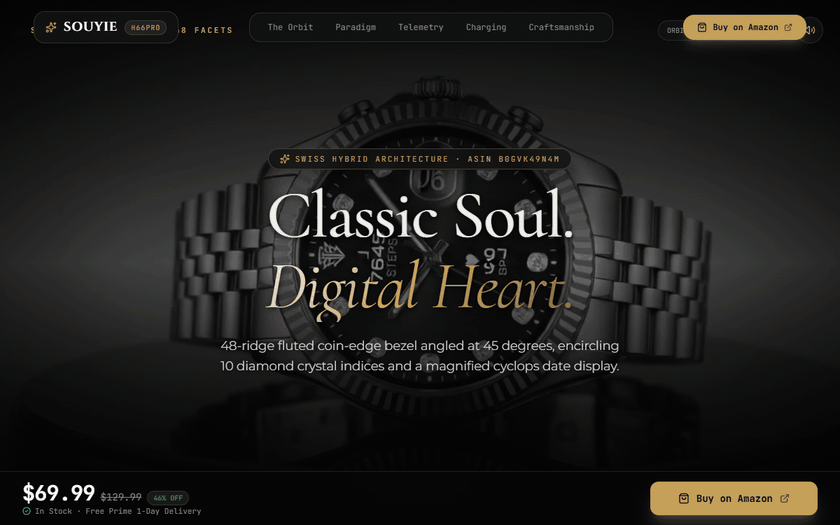
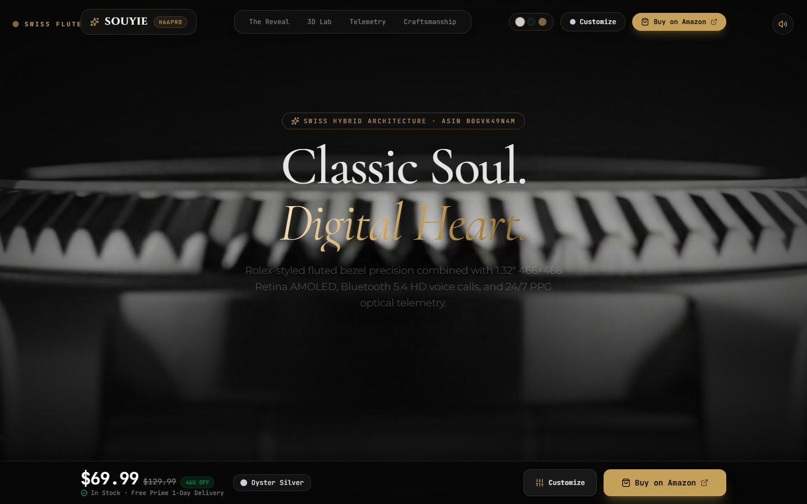
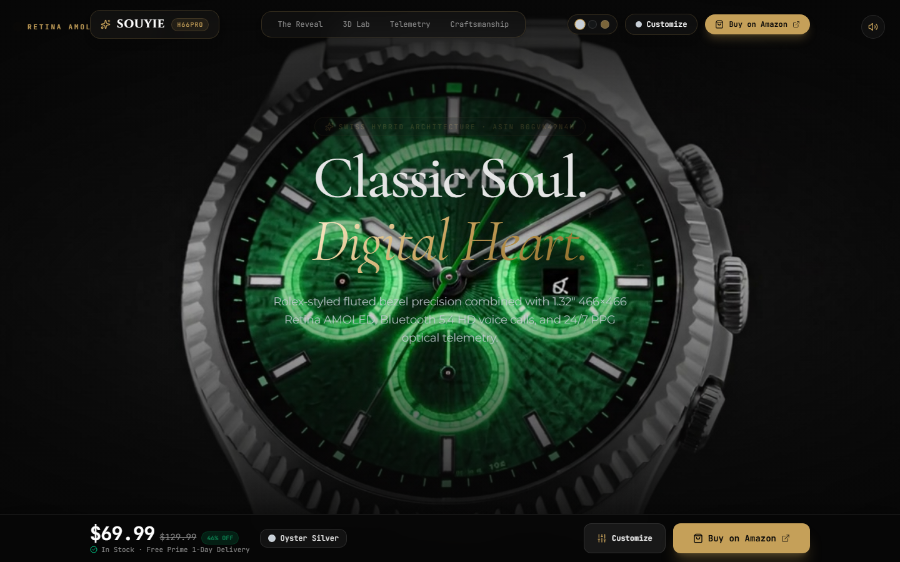
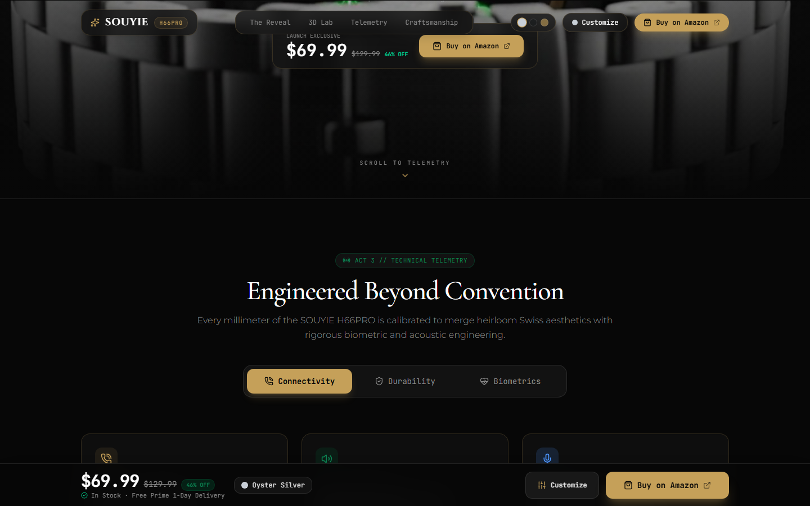
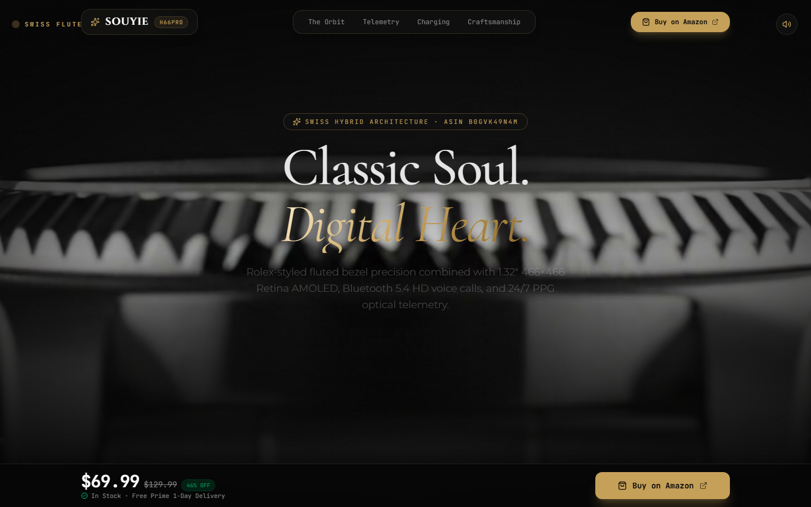

<div align="center">

# ⌚ SOUYIE H66PRO // Luxury Horology Landing

**Classic Soul. Digital Heart.**  
*Swiss fluted bezel craftsmanship meeting Silicon Valley biometric telemetry.*

[](https://react.dev/)
[](https://www.typescriptlang.org/)
[](https://vitejs.dev/)
[](https://threejs.org/)
[](https://tailwindcss.com/)
[](https://greensock.com/gsap/)

<br />

<!-- Showcase GIF -->


<br />
<br />

[Explore Experience](#-key-features) • [Tech Stack](#-technical-architecture) • [Getting Started](#-getting-started) • [Design System](#-design-system)

</div>

---

## ✨ Overview

**SOUYIE H66PRO** is an ultra-premium, interactive 3D landing page engineered for high-conversion horological luxury. It pairs timeless mechanical watch aesthetics—such as a 48-ridge coin-edge fluted bezel, magnified cyclops date window, and 10 diamond crystal indices—with modern biometric and acoustic technology.

The landing page is architected around an editorial scroll journey with buttery-smooth 60–120 FPS canvas frame scrubbing, interactive specs matrixes, and tactile audio feedback.

---

## 🚀 Key Features

### 1. 🎞️ High-Precision Canvas Scrub Engine (Act 1: Reveal)
- **192-Frame Double-Buffered Scrub**: Seamlessly renders preloaded 1080p orbital imagery locked to user scroll velocity.
- **GSAP ScrollTrigger + Lenis**: Hardware-accelerated inertial momentum scrolling with zero jank or frame tearing.
- **Adaptive Resolution & DPR Scaling**: Automatically balances canvas DPI for crisp Retina displays without GPU thermal throttling.

### 2. ⚖️ Paradigm Shift Comparison (Act 1.5)
- Side-by-side comparative architectural breakdown between **Traditional Commodity Wearables** (disposable plastic casing, flat OLED slabs) versus **Heirloom Hybrid Horology** (surgical 316L stainless steel, fluted bezel geometry, optical sapphire).

### 3. 📡 Technical Telemetry Matrix (Act 2)
- Interactive tabbed engineering breakdown covering:
  - **Connectivity**: Bluetooth 5.4 HD voice calling, independent acoustic chamber, and noise-canceling dual MEMS microphones.
  - **Durability**: IP68 and 5ATM water resistance rating with high-tensile PVD coating.
  - **Biometrics**: 4-point optical photoplethysmography (PPG) array tracking 24/7 heart rate, SpO2, and sleep stages.

### 4. ⚡ Magnetic Fast Charging Simulation (Act 3)
- Real-time animated inductive charging pod visualization demonstrating 0–100% rapid top-up telemetry.

### 5. 🏛️ Swiss Craftsmanship Bento Grid
- Modular high-density bento grid highlighting metallurgical alloy composition, 45° diamond-milled fluted ridges, and cyclops magnification optics.

### 6. 🔊 Tactile Web Audio Synthesizer
- Custom-built procedural Web Audio sound synthesizer producing subtle mechanical clicks and metallic haptic chimes upon interaction.

---

## 🛠️ Technical Architecture

| Layer | Technologies |
| :--- | :--- |
| **Framework & Core** | [React 19](https://react.dev/), [TypeScript 5](https://www.typescriptlang.org/), [Vite 8](https://vitejs.dev/) |
| **3D & Canvas** | [Three.js](https://threejs.org/), [@react-three/fiber](https://r3f.docs.pmnd.rs/), [@react-three/drei](https://github.com/pmndrs/drei), HTML5 2D Canvas Scrubbing |
| **Motion & Scroll** | [GSAP 3](https://greensock.com/gsap/), [ScrollTrigger](https://greensock.com/scrolltrigger/), [Lenis](https://lenis.darkroom.engineering/) |
| **Styling & UI** | [Tailwind CSS v4](https://tailwindcss.com/), [Lucide React](https://lucide.dev/), Custom Typography (`Cinzel`, `Playfair Display`) |
| **Linter & Tooling** | [Oxlint](https://oxc.rs/), PostCSS, Autoprefixer |

---

## 📸 Visual Showcase

<div align="center">

| Hero Reveal | Zoomed Dial Telemetry |
| :---: | :---: |
|  |  |

| Technical Telemetry | Clean Minimal View |
| :---: | :---: |
|  |  |

</div>

---

## 💻 Getting Started

### Prerequisites
- **Node.js**: `v20.x` or later (tested on Node v24)
- **npm** or **pnpm** / **yarn**

### 1. Clone the repository
```bash
git clone https://github.com/SkikriHassane01/luxury-smartwatch-landing.git
cd luxury-smartwatch-landing
```

### 2. Install dependencies
```bash
npm install
```

### 3. Run development server
```bash
npm run dev
```
Open [http://localhost:5173](http://localhost:5173) in your browser.

### 4. Build for production
```bash
npm run build
```
The optimized bundle will be compiled to the `dist/` directory.

---

## 🎨 Design System

- **Background Obsidian**: `#070707`
- **Surface Elevation**: `#0E0E10` / `#16161A`
- **Horology Champagne Gold**: `#C5A059`
- **Emerald Accent**: `#00D18F`
- **High-Contrast Text**: `#E5E5E5`
- **Muted Editorial Mono**: `#8A8A8A`

---

## 📄 License

Distributed under the MIT License. See `LICENSE` for more information.

---

<div align="center">
  <sub>Crafted with precision for horology enthusiasts & digital craftsmen.</sub>
</div>
